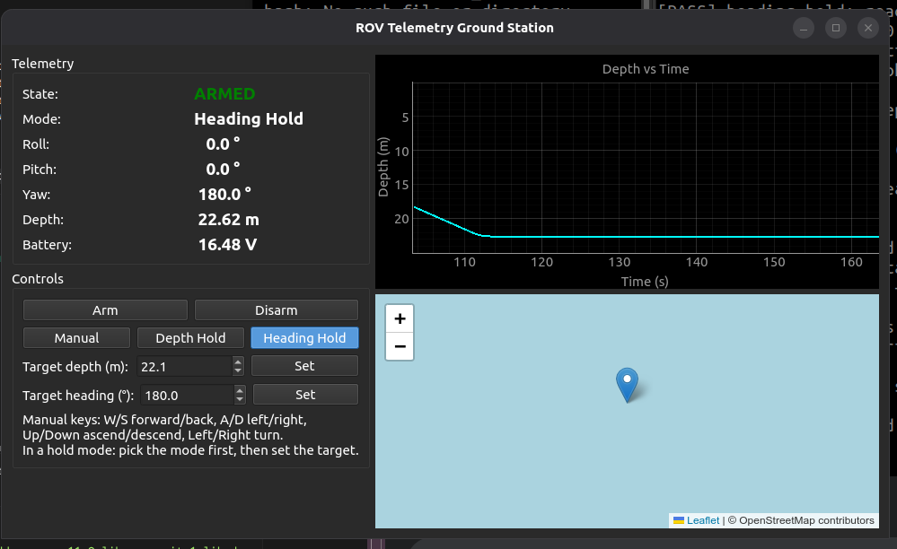

# ROV Telemetry Ground Station

A Python-based desktop application that simulates an underwater Remotely Operated Vehicle (ROV) and provides an operator interface for controlling and monitoring its telemetry.

The application includes a physics-based simulation, manual and assisted control modes, safety mechanisms, real-time telemetry visualization, a live depth-versus-time plot, and an embedded OpenStreetMap view.

> **Project Type:** Desktop Application  
> **Language:** Python  
> **GUI Framework:** PySide6 (Qt)  
> **Visualization:** PyQtGraph  
> **Mapping:** Leaflet + OpenStreetMap

---

## 1. Project Overview

The ROV Telemetry Ground Station simulates the interaction between an underwater ROV and its operator.

The operator can control the simulated vehicle, monitor its orientation and movement, observe battery voltage, and visualize its geographical position through an embedded map.

The project is designed as a native desktop application rather than a browser-based application. The simulation and control logic run locally without requiring physical ROV hardware.

## 2. Features

- **ROV Physics Simulation:** Simulates surge, sway, heave, and yaw movement.
- **Thruster Response:** Implements a first-order low-pass filter to simulate thruster response delay.
- **Manual Control:** Allows vehicle movement through keyboard inputs.
- **Depth Hold Mode:** Uses feedback control to maintain a target depth.
- **Heading Hold Mode:** Uses feedback control to maintain a target heading.
- **Arming and Disarming:** Provides vehicle arming controls with zero-thrust safety protection.
- **Input Watchdog:** Automatically sets manual commands to zero after one second without operator input.
- **Live Telemetry:** Displays armed state, operating mode, roll, pitch, yaw, depth, and battery voltage.
- **Depth Plot:** Displays a live depth-versus-time graph.
- **Embedded Map:** Displays the simulated vehicle position using OpenStreetMap.
- **Responsive Interface:** Separates physics updates from dashboard refresh operations.

## 3. System Architecture

The application is divided into separate modules to keep simulation, control, and visualization logic independent.

```text
rov_ground_station/
│
├── rov_sim.py
│   └── ROV physics and state simulation
│
├── controller.py
│   └── Arming, safety logic and control modes
│
├── main.py
│   └── Desktop interface and telemetry dashboard
│
├── geo.py
│   └── Local coordinate to geographic coordinate conversion
│
├── test_task1.py
│   └── Physics simulation tests
│
├── test_task2.py
│   └── Controller and safety tests
│
├── test_task4.py
│   └── Geographic coordinate conversion tests
│
├── requirements.txt
│   └── Python dependencies
│
└── README.md
    └── Project documentation
```

### Module Responsibilities

| Module | Responsibility |
|---|---|
| `rov_sim.py` | Simulates vehicle physics, movement, orientation, thruster response, and battery drain. |
| `controller.py` | Implements manual control, assisted modes, arming logic, and safety mechanisms. |
| `main.py` | Provides the desktop GUI, operator controls, telemetry, plot, and embedded map. |
| `geo.py` | Converts local North/East coordinates into latitude and longitude. |

## 4. ROV Simulation

The physics engine uses a fixed simulation time step of 0.02 seconds, corresponding to a 50 Hz update frequency.

Four normalized control inputs are supported:

| Axis | Positive Direction |
|---|---|
| Surge | Forward |
| Sway | Right |
| Heave | Down |
| Yaw | Clockwise rotation |

Commands are normalized between -1.0 and +1.0.

### Physics Model

The simulation incorporates:

**Thruster response delay**

A first-order low-pass filter models the gradual response of thrusters.

\[
T_{new}=T_{old}+\alpha(T_{command}-T_{old})
\]

\[
\alpha=\frac{\Delta t}{\tau+\Delta t}
\]

**Acceleration and drag**

Vehicle acceleration is calculated using thrust and linear drag.

\[
a=Au-Dv
\]

Where:

- \(A\) = acceleration gain
- \(u\) = actual thrust
- \(D\) = drag coefficient
- \(v\) = current velocity

Velocity is updated using Euler integration:

\[
v_{new}=v_{old}+a\Delta t
\]

**Position integration**

\[
x_{new}=x_{old}+v_N\Delta t
\]

\[
y_{new}=y_{old}+v_E\Delta t
\]

Depth is positive downward and is constrained to remain non-negative.

### Coordinate Transformation

The simulator uses a body-frame coordinate system for vehicle movement and converts it into a North-East world coordinate system using the current yaw angle.

\[
v_N=v_{surge}\cos(\psi)-v_{sway}\sin(\psi)
\]

\[
v_E=v_{surge}\sin(\psi)+v_{sway}\cos(\psi)
\]

This allows forward and sideways movement to be represented correctly in the world coordinate system as the vehicle changes heading.

## 5. Control Modes and Safety

The controller supports three operating modes:

| Mode | Description |
|---|---|
| Manual | Operator directly controls the four movement axes. |
| Depth Hold | Feedback control adjusts heave to maintain the target depth. |
| Heading Hold | Feedback control adjusts yaw to maintain the target heading. |

### Safety Mechanisms

- The vehicle cannot generate thrust while disarmed.
- Actual thrust is immediately reset to zero on disarming.
- Manual commands are set to zero after one second without operator input.
- Thruster commands are constrained to the range [-1, +1].
- Depth is prevented from becoming negative.

The controller uses proportional-derivative (PD) feedback for depth and heading hold.

## 6. Telemetry and Visualization

The desktop interface provides:

- Armed/disarmed status
- Current operating mode
- Roll, pitch, and yaw
- Current depth
- Battery voltage
- Target depth and heading controls
- Live depth-versus-time plot
- Embedded OpenStreetMap view

The depth graph displays changes in vehicle depth over time, while the map displays its simulated geographical position.

### Screenshots

**Ground Station Dashboard**



## 7. Technology Stack

| Technology | Purpose |
|---|---|
| Python 3 | Core programming language |
| PySide6 | Native desktop GUI |
| Qt | Application framework |
| PyQtGraph | Real-time plotting |
| NumPy | Numerical computing |
| Qt WebEngine | Embedded map rendering |
| Leaflet | Interactive map |
| OpenStreetMap | Map tiles and geographical visualization |

The application uses OpenStreetMap tiles through the embedded map view, so an internet connection is required for map tiles to load.

## 8. Installation and Setup

### Prerequisites

- Python 3.10 or later
- pip
- Ubuntu/Linux or another supported desktop environment
- Internet connection for OpenStreetMap tiles

### Step 1: Clone the repository

```bash
git clone https://github.com/YOUR_USERNAME/rov-ground-station.git
```

### Step 2: Navigate to the project directory

```bash
cd rov-ground-station
```

### Step 3: Create a virtual environment

```bash
python3 -m venv venv
```

### Step 4: Activate the environment

```bash
source venv/bin/activate
```

### Step 5: Install dependencies

```bash
pip install --upgrade pip
pip install -r requirements.txt
```

### Step 6: Run the application

```bash
python main.py
```

## 9. Running Tests

The project includes individual test scripts for the simulation, controller, and geographic conversion modules.

Run the tests from the project root:

```bash
python test_task1.py
```

```bash
python test_task2.py
```

```bash
python test_task4.py
```

### Test Coverage

**Task 1: Physics Simulation**
- Zero-thrust behaviour
- Gradual thruster response
- Velocity and drag behaviour
- Depth movement and surface constraint
- Yaw and directional movement
- Battery voltage reduction

**Task 2: Controller and Safety**
- Disarmed thrust protection
- Immediate thrust reset on disarming
- Manual input timeout
- Depth Hold behaviour
- Heading Hold behaviour
- Heading wraparound
- Mode switching

**Task 4: Geographic Conversion**
- Origin coordinate validation
- Northward displacement
- Eastward displacement
- Coordinate round-trip checks
- Southwest displacement

## 10. Design Limitations

This project is a simplified ROV simulation intended for ground-station demonstration and software testing.

- The physics model uses four commanded axes: surge, sway, heave, and yaw.
- Roll and pitch are approximate display values, not outputs of a complete six-degree-of-freedom dynamics model.
- Hydrodynamic drag is represented using a simplified linear model.
- Battery drain is approximated using thrust magnitude and a constant base drain.
- Geographic coordinates are estimated using a local North-East approximation.
- The simulator does not communicate with physical ROV hardware.

These simplifications keep the implementation lightweight while demonstrating the main control, telemetry, and visualization concepts.

## 11. AI-Assisted Development Disclosure

AI tools were used as development assistance during parts of the project, including code guidance, debugging support, and documentation preparation.

The implementation was reviewed and tested as part of the development process. The developer is responsible for understanding and explaining the submitted code.

## 12. Future Improvements

Potential extensions include:

- More realistic hydrodynamic modelling.
- Full six-degree-of-freedom vehicle dynamics.
- Joystick integration.
- ROS 2 or MAVLink communication.
- More detailed battery and power modelling.
- Logging and exporting telemetry data.
- Additional fault detection and safety monitoring.

## 13. Author

**Developed as part of the ROV Telemetry Ground Station Technical Assessment.**

